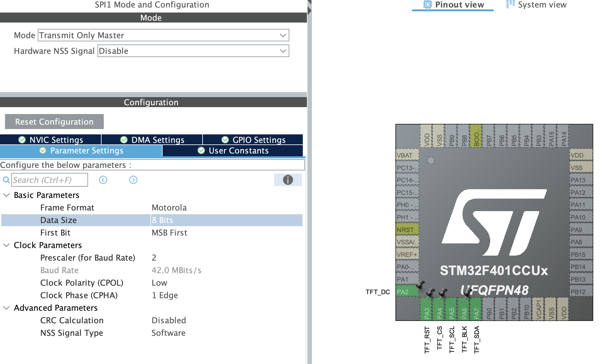

[Readme UA](README_UA.md) | [Readme EN](README.md)

# High-Speed ST7789 Driver for STM32

A driver for ST7789-based displays that transfers data over SPI using DMA.

The demo project is configured for the **STM32F401CCU6** and a **240 × 320** display. The current SPI1 configuration uses a `/2` prescaler (a theoretical SCK frequency of up to 42 MHz; the actual speed depends on the display and wiring).

## Features

- Transfers display data over SPI TX DMA.
- Supports RGB565 pixel data (16-bit).
- DMA modes for incrementing through a pixel buffer and repeatedly transmitting a single color when filling an area.
- Graphics primitives: pixels, lines, rectangles, screen fills, and bitmap drawing.
- Display orientation, window offsets, and backlight control.
- Built-in fonts and text-rendering functions, with support for Adafruit GFX fonts.

## Demo Video

[Watch the driver demo](st7789v_demo.mp4)

----

<video src="st7789v_demo.mp4" width="100%" controls></video>

## Wiring

The following pinout matches the current project configuration:

| ST7789 | STM32F401CCU6 | Function |
|---|---|---|
| SCL / SCK | PA5 (SPI1_SCK) | SPI clock |
| SDA / MOSI | PA7 (SPI1_MOSI) | SPI data |
| DC | PA2 | Command/data selection |
| RST | PA3 | Display reset |
| CS | PA4 | Display chip select |
| BLK | PA6 | Backlight control |
| GND | GND | Common ground |
| VCC | As specified for the module | Power supply |

The MISO line is not used.

## STM32CubeMX Configuration

If you change the microcontroller or peripherals, configure the following:

1. **SPI1**:
   - Mode: `Transmit Only Master`
   - Data size: 8 bits initially. The driver switches between 8-bit transfers for commands and 16-bit transfers for pixel data.
   - Clock mode 0: CPOL Low, CPHA 1 Edge.
2. **SPI1_TX DMA**: DMA2 Stream 3, Channel 3, Memory-to-Peripheral direction, Normal mode, and peripheral address increment disabled. The driver changes memory increment and DMA alignment in [`ST7789/lcd_spi_port.c`](ST7789/lcd_spi_port.c) as needed for each transfer type.
3. Configure SCK and MOSI as SPI1 alternate-function pins, and DC, RST, CS, and BLK as GPIO outputs.
4. Make sure SPI TX DMA is linked to `hspi1->hdmatx`, and that DMA and SPI are initialized before calling `st7789_init`.



## Driver Configuration

In [`ST7789/config.h`](ST7789/config.h):

- `LCD_USE_DMA` enables DMA transfers.
- `LCD_ENABLE_TESTS` enables the graphics and text test functions.

For a different display, change the width, height, orientation, and, if necessary, the X/Y offsets in `st7789_window_data_t`. Offsets depend on the specific ST7789 module.

## Initialization and Usage

After initializing the HAL, GPIO, DMA, and SPI, pass the SPI handle and GPIO pins to the driver:

```c
#include "st7789_driver.h"
#include "gfx.h"
#include "colors.h"

st7789_spi_connected_data_t spi_data = {
    .spi = &hspi1,
    .dc  = {TFT_DC_GPIO_Port,  TFT_DC_Pin},
    .cs  = {TFT_CS_GPIO_Port,  TFT_CS_Pin},
    .rst = {TFT_RST_GPIO_Port, TFT_RST_Pin},
    .blk = {TFT_BLK_GPIO_Port, TFT_BLK_Pin},
};

st7789_window_data_t window_data = {
    .width = 240,
    .height = 320,
    .x_offset = 0,
    .y_offset = 0,
    .orientation = GFX_ORIENTATION_PORTRAIT,
};

st7789_init(&spi_data, &window_data);
gfx_init();

gfx_fill_screen(COLOR_BLACK);
gfx_fill_rect(20, 20, 120, 80, COLOR_GREEN);
```

To draw a bitmap, use `gfx_draw_bitmap(x, y, width, height, pixels)`. The buffer must contain RGB565 pixels in memory accessible to DMA. Other low-level driver functions are declared in [`ST7789/st7789_driver.h`](ST7789/st7789_driver.h), and graphics functions are declared in [`ST7789/gfx.h`](ST7789/gfx.h).

## Development Environment

The demo project was developed in VS Code using CMake and an ARM GNU toolchain. It can also be regenerated for STM32CubeIDE if desired.

## Acknowledgements

The driver was inspired by the implementations in [Floyd-Fish/ST7789-STM32](https://github.com/Floyd-Fish/ST7789-STM32) and [deividAlfa/ST7789-STM32-uGUI](https://github.com/deividAlfa/ST7789-STM32-uGUI).
