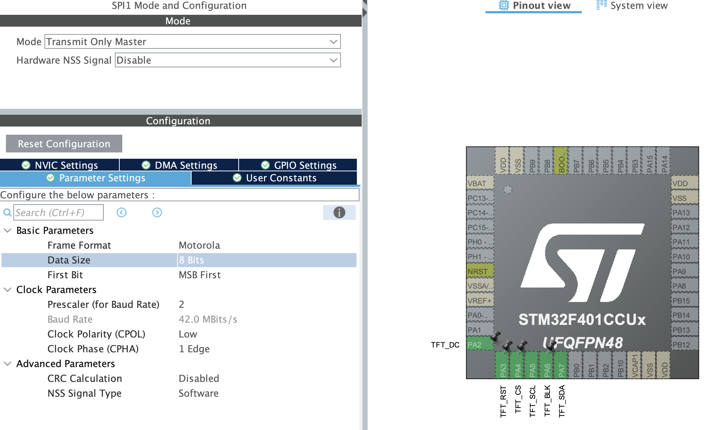

[Readme EN](README.md) | [Readme UA](README_UA.md)

# Високошвидкісний драйвер ST7789 для STM32

Драйвер для дисплеїв на контролері **ST7789**, що передає дані через SPI з використанням DMA.

Демо-проєкт налаштований для **STM32F401CCU6** та дисплея **240×320**. Поточна конфігурація SPI1 використовує дільник `/2` (теоретично до 42 Мбіт/с для SCK; фактична швидкість залежить від дисплея та з'єднань).

## Можливості

- Передавання даних дисплею через SPI TX DMA.
- Передавання пікселів у форматі RGB565 (16 біт).
- DMA-режими для послідовного буфера пікселів і повторного передавання одного кольору під час заливання.
- Графічні примітиви: піксель, лінія, прямокутник, заливання екрана та виведення bitmap.
- Підтримка орієнтації дисплея, зсувів вікна та керування підсвіткою.
- Вбудовані шрифти й функції для виведення тексту, також є підтримка шрифтів Adafruit GFX.

## Відео

https://github.com/user-attachments/assets/6f021558-bcc2-4d54-b50a-3eb97e57f52f


## Підключення

Наведена розводка відповідає поточній конфігурації проєкту:

| ST7789 | STM32F401CCU6 | Призначення |
|---|---|---|
| SCL / SCK | PA5 (SPI1_SCK) | Тактовий сигнал SPI |
| SDA / MOSI | PA7 (SPI1_MOSI) | Дані SPI |
| DC | PA2 | Вибір команди або даних |
| RST | PA3 | Скидання дисплея |
| CS | PA4 | Вибір дисплея |
| BLK | PA6 | Керування підсвіткою |
| GND | GND | Спільна земля |
| VCC | За специфікацією модуля | Живлення |

Лінія MISO не використовується.

## Налаштування STM32CubeMX

Якщо змінюєте мікроконтролер або периферію, налаштуйте:

1. **SPI1**:
 - Mode: `Transmit Only Master`,
 - Data Size: 8bits. Драйвер сам перемикає між 8 і 16 bits: команди 8bits, малювання 16bits.
 - Режим тактування 0, тобто CPOL: Low, CPHA: 1 Edge
2. **SPI1_TX DMA**: DMA2 Stream 3, Channel 3, напрямок Memory to Peripheral, Normal mode, без інкременту адреси периферії. У `ST7789/lcd_spi_port.c` драйвер перемикає memory increment та вирівнювання DMA відповідно до типу передавання.
3. Налаштуйте SCK і MOSI як альтернативні функції SPI1, а DC, RST, CS і BLK — як GPIO-виходи.
4. Переконайтеся, що SPI TX DMA прив'язаний до `hspi1->hdmatx`, а DMA і SPI ініціалізуються до виклику `st7789_init`.



## Налаштування драйвера

У [`ST7789/config.h`](ST7789/config.h):

- `LCD_USE_DMA` вмикає DMA-передавання.
- `LCD_ENABLE_TESTS` вмикає тестові функції графіки та тексту.

Для іншого дисплея змініть ширину, висоту, орієнтацію та, за потреби, зсуви X/Y у `st7789_window_data_t`. Зсуви залежать від конкретного модуля ST7789.

## Ініціалізація та використання

Після ініціалізації HAL, GPIO, DMA та SPI передайте драйверу SPI-дескриптор і GPIO-виводи:

```c
#include "st7789_driver.h"
#include "gfx.h"
#include "colors.h"

st7789_spi_connected_data_t spi_data = {
    .spi = &hspi1,
    .dc  = {TFT_DC_GPIO_Port,  TFT_DC_Pin},
    .cs  = {TFT_CS_GPIO_Port,  TFT_CS_Pin},
    .rst = {TFT_RST_GPIO_Port, TFT_RST_Pin},
    .blk = {TFT_BLK_GPIO_Port, TFT_BLK_Pin},
};

st7789_window_data_t window_data = {
    .width = 240,
    .height = 320,
    .x_offset = 0,
    .y_offset = 0,
    .orientation = GFX_ORIENTATION_PORTRAIT,
};

st7789_init(&spi_data, &window_data);
gfx_init();

gfx_fill_screen(COLOR_BLACK);
gfx_fill_rect(20, 20, 120, 80, COLOR_GREEN);
```

Для передавання bitmap використовуйте `gfx_draw_bitmap(x, y, width, height, pixels)`. Буфер має містити пікселі RGB565 у пам'яті, доступній DMA. Інші низькорівневі функції драйвера оголошені у [`ST7789/st7789_driver.h`](ST7789/st7789_driver.h), а графічні — у [`ST7789/gfx.h`](ST7789/gfx.h).

## Середовище розробки

Демо проєкт робився в VS code з CMake toolchain, але при бажанні його легко можна перегенерувати для STM32CubeIDE.

## Подяка

Під час створення драйвера надихався реалізаціями [Floyd-Fish/ST7789-STM32](https://github.com/Floyd-Fish/ST7789-STM32) та [deividAlfa/ST7789-STM32-uGUI](https://github.com/deividAlfa/ST7789-STM32-uGUI).
